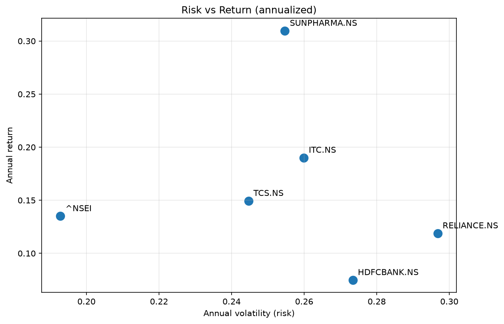
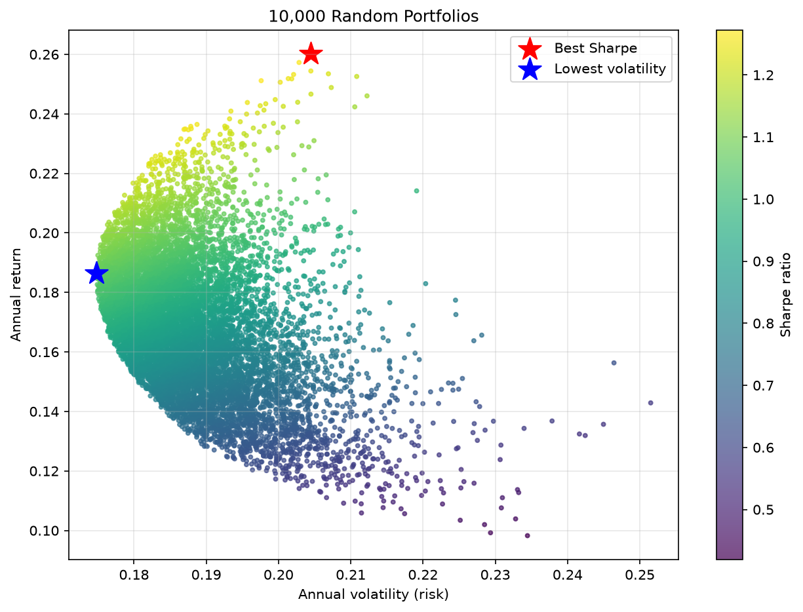

# Stock Return & Risk Analyzer

Analysis of the risk and return of 5 NIFTY 50 stocks and the NIFTY index, and whether combining stocks reduces risk.

## Problem
How risky and how rewarding are some NIFTY 50 stocks, and can combining them reduce risk?

## Data
- Source: Yahoo Finance via `yfinance`
- Period: 2020-01-01 to 2025-01-01 (daily closing prices)
- Tickers: TCS.NS, HDFCBANK.NS, RELIANCE.NS, ITC.NS, SUNPHARMA.NS, ^NSEI

## Methods
- Simple and log returns
- Distribution analysis: mean, std, skewness, kurtosis, histograms, QQ-plots, Jarque-Bera test
- Risk metrics: annual return, volatility, Sharpe ratio, rolling volatility, max drawdown, VaR 95%, correlation
- Portfolio: covariance matrix, 10,000 random portfolios, train/test split (2020-2023 vs 2024)

## Key results
- [Your finding: are returns normal?]
- [Your finding: best Sharpe stock and highest return stock]
- [Your finding: most correlated pair]
- [Your finding: did the best portfolio beat equal weights in 2024?]

## Limitations
- Only 5 years of past data, and past performance does not guarantee future results
- Returns are not normal (fat tails), so volatility underestimates crash risk
- No transaction costs, and only 5 stocks
- Best weights chosen on past data may not stay best

## How to run
pip install -r requirements.txt
python main.py

Full step-by-step analysis is in the `notebooks/` folder.